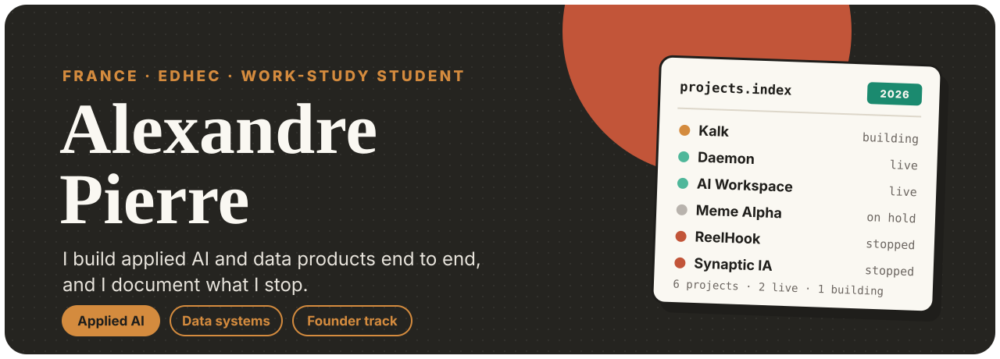
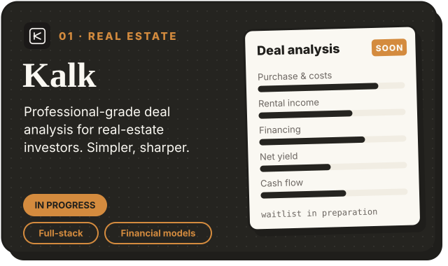
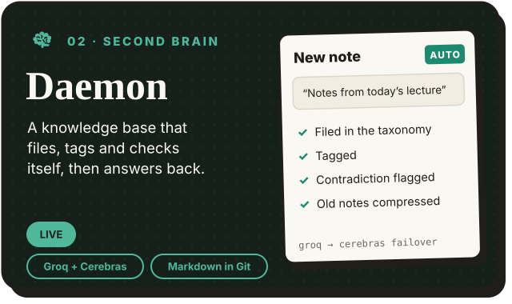
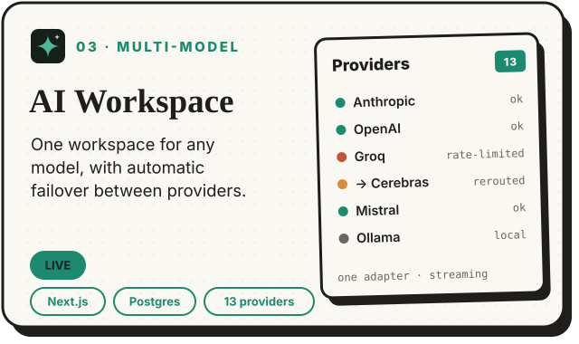
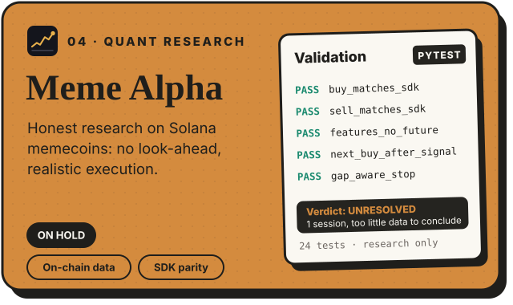
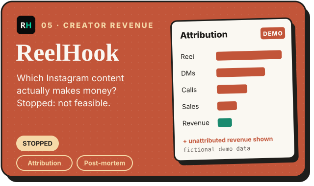
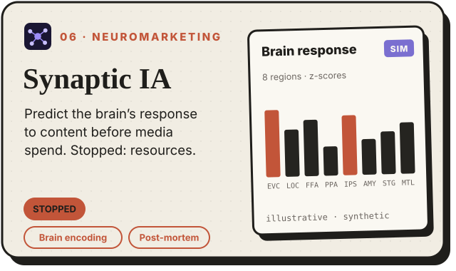
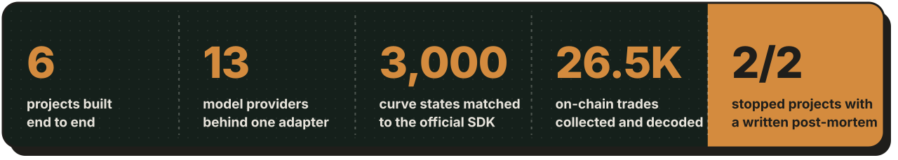

  

  
  
  

I am a work-study student at EDHEC building **applied AI, data and product systems end to end**: framing the problem, designing the architecture, writing the code, shipping it, and writing an honest review when a project should stop. My current focus is **Kalk**, a real-estate analysis platform I build with a partner who leads the financial models. Everything else on this page either runs today or ended with a documented decision.

## 🛠️ What I'm building

  
  
  
  
  
  

  Explore: <a href="https://github.com/Neemmmooooo/second-brain">Daemon</a> · <a href="https://github.com/Neemmmooooo/ai-workspace">AI Workspace</a> · more repositories coming soon

## 📊 By the numbers

  

> [!IMPORTANT]
> **How I work.** I start from a concrete problem and build the smallest system that genuinely solves it. I de-risk the hardest assumptions first (willingness to pay, data access, barriers to entry) before polishing anything. And I document what I stop: a project ended deliberately is worth more than one left to drift.

<b>Context, goals and status for each project</b>

 

<table>
  <tr>
    <td width="84" align="center"></td>
    <td>
      <h3>Kalk &nbsp;🟢 In progress</h3>
      <b>Context:</b> real-estate deal analysis still relies on hand-built spreadsheets that are hard to audit and share, while professional tools are either complex or reserved for large firms. 
      <b>Goal:</b> give investors professional-grade analysis tools that are simpler to use and more accurate. 
      <b>Status:</b> final stage of development, with a waitlist launch in preparation. I build the full stack on my own; a partner with real-estate expertise leads the financial models. Private codebase, public showcase coming soon.
    </td>
  </tr>
  <tr>
    <td width="84" align="center"></td>
    <td>
      <h3><a href="https://github.com/Neemmmooooo/second-brain">Daemon</a> &nbsp;🟡 Live · no longer actively developed</h3>
      <b>Context:</b> what I learn (courses, projects, reading) ends up scattered, and I struggle to retrieve what I already know. 
      <b>Goal:</b> a second brain that organises itself and surfaces the right information when I ask a question. 
      <b>What I built:</b> an AI knowledge architect that files notes into a fixed taxonomy, tags them, flags contradictions with existing knowledge and compresses older notes. It fails over between model providers during outages (Groq → Cerebras). Notes remain plain Markdown in GitHub, readable by Obsidian, Claude and the web app.
    </td>
  </tr>
  <tr>
    <td width="84" align="center"></td>
    <td>
      <h3><a href="https://github.com/Neemmmooooo/ai-workspace">AI Workspace</a> &nbsp;🟡 Live · no longer actively developed</h3>
      <b>Context:</b> every model provider has its own interface, quotas and outages, and switching tools mid-task breaks the flow. 
      <b>Goal:</b> work with any model without worrying about which provider is available. 
      <b>What I built:</b> a streaming chat workspace with 13 providers behind a single adapter layer, automatic failover on outages or rate limits, task-based model routing and encrypted API keys. Built with Next.js and Postgres.
    </td>
  </tr>
  <tr>
    <td width="84" align="center"></td>
    <td>
      <h3>Meme Alpha &nbsp;⏸️ Research on hold</h3>
      <b>Context:</b> public memecoin analyses assume unrealistic entries at the launch price, leak future information into their indicators and ignore trading costs. 
      <b>Goal:</b> determine what can honestly be said about price continuation in Solana memecoins, using rigorous data and a realistic execution model. 
      <b>What I built:</b> an on-chain data collector, momentum indicators, labelling free of look-ahead bias and an execution simulator validated against the official SDK. The dataset is still too small to draw conclusions, so the project documents its limitations and what it would take to go further. <i>Research project, not financial advice.</i> Public repository coming soon.
    </td>
  </tr>
  <tr>
    <td width="84" align="center"></td>
    <td>
      <h3>ReelHook &nbsp;⚫ Discontinued · public post-mortem coming soon</h3>
      <b>Context:</b> Instagram tools schedule or generate content, but none of them shows which content actually drives revenue. 
      <b>Goal:</b> attribute every piece of content to the messages, calls, sales and revenue it generates. 
      <b>Why it stopped:</b> not feasible. The required data was unreliable, small accounts had limited ability to pay, and large brands were not interested. <b>Lesson:</b> validate willingness to pay and data access before building.
    </td>
  </tr>
  <tr>
    <td width="84" align="center"></td>
    <td>
      <h3>Synaptic IA &nbsp;⚫ Discontinued · public post-mortem coming soon</h3>
      <b>Context:</b> brands judge content on intuition, through focus groups, or with fMRI studies costing tens of thousands of euros. 
      <b>Goal:</b> predict how the brain responds to a piece of content across audiences (for example, by generation) before any media spend. 
      <b>Why it stopped:</b> insufficient resources (capital, technology, specialised team), and a major player released an equivalent model. <b>Lesson:</b> assess barriers to entry and the competitive landscape early.
    </td>
  </tr>
</table>

## 🧰 Tools & technologies

**AI & agents** 

**Development** 

**Data & quality** 

**Deployment & product** 

**Creative & knowledge management** 

Focus areas: applied AI · data · full-stack development · product
